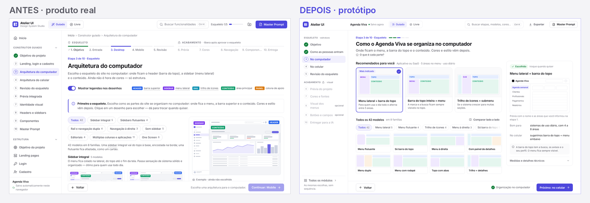
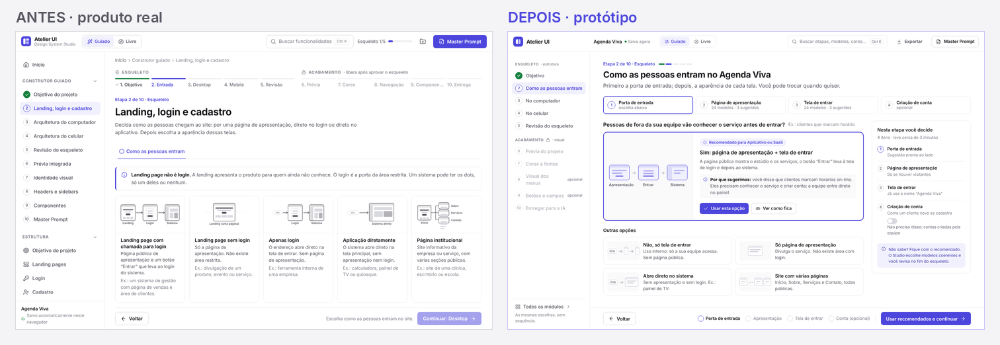
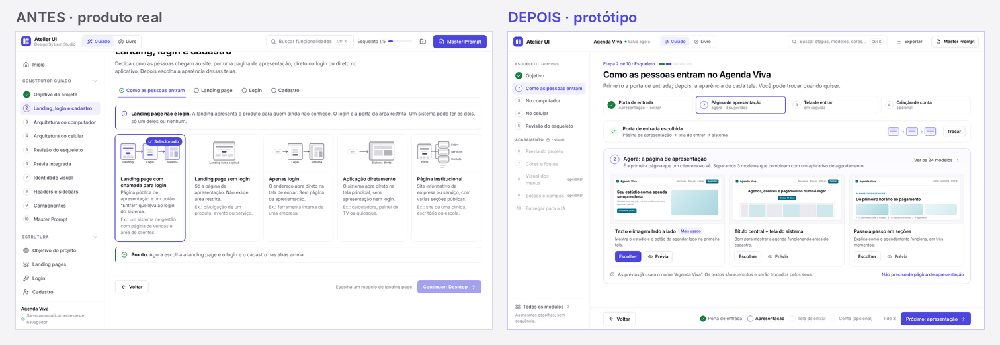
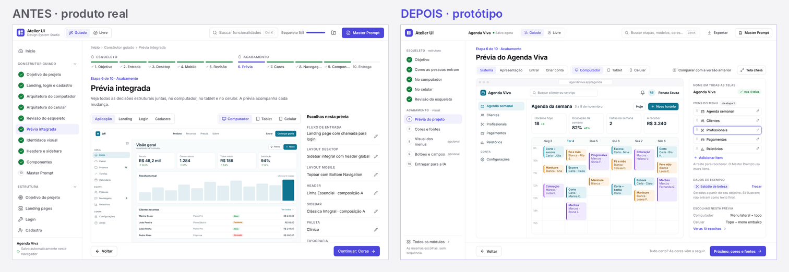
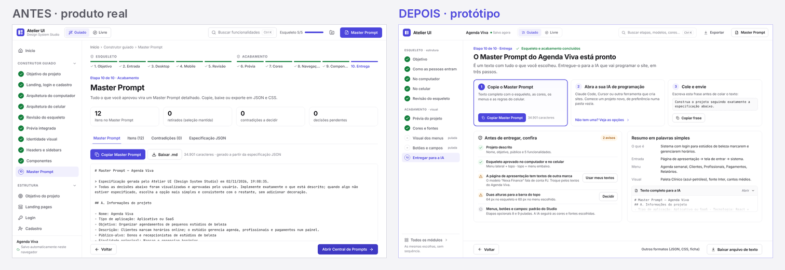

# Fase 8 · Crítica de design de produto (UI/UX): Atelier UI, Design System Studio

> **Autor:** agente de IA no papel de diretor de design de produto, contratado para uma crítica independente. **Data:** 02/11/2026.
> **Objeto:** versão congelada servida em `http://127.0.0.1:4300/` (build de produção, rotas por hash), código em `design-system-studio/src` (só leitura).
> **Pastas:** capturas em [`capturas/`](capturas/) (101 arquivos) e protótipos em [`prototipos/`](prototipos/) (6 pares antes × depois e 6 comparativos).

## 0. Como ler este relatório

- **[Obj]** marca um problema **objetivo**: mensurável ou verificável (sobreposição, recorte, contraste, contagem, inconsistência de comportamento, texto errado). **[Est]** marca um **julgamento estético** ou de preferência. Pessoas competentes podem discordar de um [Est]; de um [Obj], não.
- **Origem da evidência.** Usei o produto primeiro (desktop 1440×900 e 1920×1080; celular 390×844 com emulação móvel). Só **depois** li os relatórios dos usuários simulados da fase 1 (A1 leigo, A2 intermediário, A3 desenvolvedor, A4 designer, A5 celular, A6 impaciente). Em cada item indico a fonte: **(eu)** quando vi por conta própria, **(eu + A1…)** quando também aparece na fase 1, **(A…)** quando só a fase 1 encontrou e eu não verifiquei.
- **Nomes de captura.** `d…` = desktop 1440×900, `w…` = 1920×1080, `m…` = celular 390×844 (DPR 2). As capturas `*-full.png` são de página inteira; nelas a barra fixa aparece no meio da imagem, que é um efeito da captura e não um defeito do produto.
- **Projeto de teste.** "Agenda Viva", um app de agendamento para estúdios de beleza (tipo "Aplicativo ou SaaS", 5 funcionalidades: Agenda semanal, Clientes, Profissionais, Pagamentos, Relatórios).

---

## 1. Veredito executivo

**O Atelier UI já tem a matéria-prima de um produto comercial**: identidade branca contida, um único acento índigo, tipografia Inter bem renderizada, galerias com miniaturas reais e profissionais (as 24 landings e as prévias interativas de headers e sidebars são de nível de mercado), editor de componentes com painel de propriedades e clique na prévia, e uma promessa clara ("primeiro o esqueleto, depois o acabamento").

**O que o separa das ferramentas profissionais de criação visual não é acabamento visual. É arquitetura de informação e, sobretudo, a ausência do projeto do usuário na tela.** O Studio mostra o **catálogo**, não o **projeto**:

1. **As prévias não representam o projeto.** [Obj] Na prévia integrada, o mesmo projeto aparece com **três marcas fictícias diferentes**: "Ipê" no computador depois de escolher um header, "Orla" no celular e "Nexa" na landing. O menu lateral mostra "Painel, Projetos, Tarefas, Calendário", e não as 5 funcionalidades declaradas. **Quanto mais o usuário escolhe, menos a prévia se parece com o projeto dele**: antes de escolher o header ela mostrava "Agenda Viva", depois passou a mostrar "Ipê" com os links de marketing "Produto · Recursos · Preços · Sobre · Começar grátis" dentro do sistema logado (`d21` × `d39`). O conteúdo da landing de exemplo (fintech "Nexa") entra detalhado no Master Prompt (`prompt.md`, linhas 20–31).
2. **O esqueleto vem antes do acabamento, mas a etapa 2 sobrecarrega.** São quatro decisões escondidas em abas (fluxo, landing, login, cadastro). Depois da primeira escolha o Studio diz "Pronto. Agora escolha… nas abas acima" e deixa o botão "Continuar" desabilitado, sem lista do que falta (`d08b`). Foi o ponto de abandono previsto para a persona leiga (A1).
3. **As galerias são enormes e não começam pelo que serve ao usuário.** A tela de headers tem 18.517 px de altura, as paletas 9.750 px e os layouts de computador 7.972 px. A 1440×900, a primeira opção escolhível aparece por volta de y = 750–780, quase no fim da primeira tela. Existem selos "Sugerido", mas não há "comece por aqui" nem caminho rápido.
4. **O fim do fluxo não ensina a usar o resultado.** A etapa final mostra 34.901 caracteres de Markdown cru, quatro contadores técnicos e um botão principal que leva a uma página praticamente idêntica (Central de Prompts).

**Notas** (rubrica na seção 7):

| Critério | Nota | Leitura |
| --- | --- | --- |
| Qualidade visual e consistência de design | **7,0 / 10** | Visual limpo e profissional, prejudicado por inconsistências objetivas de padrão (modais, seleção, toasts), escala tipográfica fraca e recortes. |
| Experiência do usuário e facilidade de uso | **5,2 / 10** | Boa orientação de progresso e bom retorno de seleção. Pesam contra: carga de decisão, jargão, prévias que não representam o projeto e um fim sem instrução de uso. |

**As cinco ações de maior retorno, em ordem:**

1. **Prévias e prompt com o conteúdo do projeto**: um nome só, itens de menu vindos das funcionalidades e editáveis, dados de exemplo do domínio, e textos de modelo marcados como provisórios. → Protótipo 04.
2. **Recomendação contextual e caminho rápido** em todas as galerias ("Recomendados para você" + "Usar recomendados e continuar"). → Protótipos 01, 03 e 06.
3. **Etapa 2 em subetapas visíveis**, com opção "não preciso disso" e uma barra de ações que diz o que falta e leva até lá. → Protótipos 01, 02 e 06.
4. **Entrega com "o que fazer agora"** (copiar → abrir a IA → colar) e **verificação antes de exportar**. → Protótipo 05.
5. **Coerência entre esqueleto e acabamento**: filtrar headers e sidebars pelo esqueleto (app × site) e fazer os componentes seguirem a identidade por padrão.

---

## 2. Método e cobertura

| Item | Detalhe |
| --- | --- |
| Percurso próprio | Início → modo guiado completo (10 etapas, preenchendo o projeto "Agenda Viva") → modo Livre → busca Ctrl K → Inspiração, Templates, Central de Prompts, Exportar, Validação, Projeto, Live Site Preview, Color System. Repetido no celular. |
| Viewports | 1440×900 (principal), 1920×1080 (`w01`–`w07`, `d02`), 390×844 com `isMobile`, `hasTouch` e DPR 2 (`m01`–`m10`). |
| Medições | Alturas de página, posição da primeira opção, largura de rolagem da barra de abas, sombra da sidebar fora da tela, contraste dos tokens de texto, escala tipográfica e pesos no CSS, busca com 9 termos. |
| Ferramentas | Playwright 1.63 + Chromium (só Chromium, sem aparelho físico); PIL para os comparativos. |
| Fase 1 | Lida **depois** do percurso próprio, para cruzar evidências (seção 9). |
| Limitações | Uma pessoa avaliadora (IA) e nenhum teste com usuários reais. O estado é salvo em `localStorage`, então alguns comportamentos dependem da ordem de uso. Não verifiquei funcionalidades de exportação de arquivos além do texto. |

---

## 3. Análise por dimensão

### 3.1 Identidade visual

**O que funciona**
- [Est] "White Canvas" coerente: fundo branco, bordas finas (`#ebebef`), sem caixas cinza, sombra só no que flutua (`tokens.css`). Atende ao desejo do dono ("muito limpa, predominantemente branca") e se aproxima da clareza das ferramentas de criação visual de massa sem copiá-las (`d01`, `d30`).
- [Obj] Um único acento índigo (`#4c46dc`, 6,5:1 sobre branco) e verde só para "concluído". As cores das legendas didáticas (HEADER azul, SIDEBAR roxo, CONTEÚDO verde) são um vocabulário próprio e útil (`d15`).

**Problemas**
- [Obj] **O acento faz trabalho demais.** Ele marca botão primário, seleção, aba ativa, link, selo "Recomendado", caixa de dica, progresso e item ativo da sidebar ao mesmo tempo. Na etapa 2 há sete elementos índigo competindo na primeira tela (`d08`). Quando tudo é índigo, "selecionado" e "clique aqui" perdem força.
- [Obj] **Caixas de aviso em toda etapa** ("Primeiro o esqueleto", "Landing page não é login", "Como escolher", "Escolha pelos olhos"), todas com a mesma borda esquerda índigo. A repetição faz o aviso virar ruído (`d07`, `d15`, `d18`, `d25`, `d27`).
- [Est] A identidade é competente, mas **anônima**: o logotipo é um quadrado genérico e não há uma assinatura visual própria. Os diagramas didáticos com etiquetas coloridas são o elemento mais original do produto e poderiam virar a linguagem da marca (ilustrações da home, estados vazios, onboarding).

### 3.2 Tipografia

**O que funciona**: Inter variável, boa renderização, títulos com espaçamento negativo e leitura confortável no corpo (15 px).

**Problemas**
- [Obj] **A escala tem degraus de 1 px**: `--fs-xs 12,5`, `--fs-sm 13,5`, `--fs-md 14,5`, `--fs-base 15` (`src/styles/tokens.css`). A razão entre degraus vizinhos fica entre 1,03 e 1,08, abaixo do que o olho distingue como nível hierárquico. A hierarquia depende então de cor e peso.
- [Obj] **13 pesos distintos** só nos arquivos de interface do Studio (`ui.css`, `shell.css`, `guided.css`, `home.css`, `layouts.css`, `components.css`): 450, 500, 520, 540, 560, 600, 620, 630, 640, 650, 680, 700 e 720. Na prática a diferença entre 620, 630 e 650 é invisível; sobram complexidade e inconsistência.
- [Obj] **Texto auxiliar sem contraste AA.** `--s-text-3` (`#7c7c87`) dá **4,13:1** sobre branco e é usado em 12,5–13,5 px: "Salvo automaticamente neste navegador", exemplos "Ex.: …" nos cartões, dicas da barra fixa (`d04`, `d07`).
- [Obj] **Rótulos de cerca de 8 px** nos diagramas da etapa 2 ("Landing", "Login", "Sistema", "site") (`d07`) e texto de **3 a 5 px** na prévia integrada no celular (`m07`).
- [Est] O H1 das etapas (30 px) e o da home (cerca de 48 px) são bons. Falta um degrau intermediário entre o título de seção (17 px) e o H1.

### 3.3 Escala de espaçamento

- [Obj] A escala existe (4, 8, 12, 16, 20, 24, 32, 40) e é usada: há 411 usos de `var(--sp-*)`. Convive, porém, com valores fora dela (6 px em 84 lugares, 10 px em 45, 14 px em 23, além de 18 e 22 px).
- [Obj] **Desalinhamentos visíveis**: títulos da faixa "Primeiro o esqueleto" em alturas diferentes (y = 976/991/991/984 em `d03`); descrições dos cartões de tipo de projeto começando em alturas diferentes (`d04`); status inline nos cartões do modo Livre ("apresentação.✓ Nexa Finance"), que muda a entrelinha da última linha (`d30`).
- [Est] O ritmo vertical dentro dos cartões é bom. O problema está **entre** os blocos: a pilha de cabeçalhos da etapa (seção 3.8).

### 3.4 Ícones

- [Obj] Família coerente de traço (estilo de contorno, cerca de 1,8 px), tamanhos constantes de 16–18 px, bom alinhamento ótico com o texto (`d01`, `d30`).
- [Obj] **Ações importantes só com ícone**: "Exportar e importar" é um ícone de pasta sem rótulo no topo (`d01`), e no celular o "Master Prompt" é só um ícone sobre fundo índigo (`m01`).
- [Est] Alguns ícones de tipo de projeto são ambíguos ("One Screen", "Outro tipo"). Os ícones dos tipos ajudariam mais se fossem miniaturas de layout do que pictogramas genéricos.

### 3.5 Hierarquia

- [Obj] **Duas ações primárias concorrem desde o primeiro acesso**: "Master Prompt", primário no topo com o projeto vazio, e "Começar no modo guiado" (`d01`) (eu + A6 #15).
- [Obj] **Cartões com quatro ações de peso parecido.** Nos headers aparecem "Selecionar" (contorno, pequeno), "Composição A/B", "Ver em tamanho grande" e "Prompt deste elemento" (`d25b`). A ação que importa, escolher, é a mais fraca.
- [Obj] **Primário repetido em massa**: 16 botões primários idênticos "Adicionar ao projeto" numa mesma página (`d27b`), mais "Prompt deste elemento" em todos os cartões e "Prompt" nos 60 cartões de paleta (`d23b`).
- [Obj] A barra fixa nomeia o destino ("Continuar: Entrada", "Continuar: Desktop"), o que é **ótimo** e deve ser mantido.

### 3.6 Organização das etapas do construtor guiado

**O esqueleto vem antes do acabamento de fato?** **Sim na sequência, não no conteúdo.**
- [Obj] A ordem respeita a filosofia: Objetivo → Entrada → Desktop → Mobile → Revisão, e o acabamento fica travado ("libera após aprovar o esqueleto") (`d04`, `d20`).
- [Obj] **Mas o acabamento contradiz o esqueleto.** A etapa 8 oferece headers de site de marketing e de loja ("Vitrine Central" com sacola e favoritos) para um esqueleto de aplicativo com menu lateral, e a "Combinação" põe um header de marketing em cima da sidebar do sistema (`d25b`, `d26c`). A etapa 9 oferece famílias com fundo escuro e vidro ("Dark Luxury", "Glassmorphism") para uma identidade clara recém-aprovada (`d27b`).
- [Obj] **Etapas que sobrecarregam:**
  - **Etapa 2**: quatro decisões em abas; antes da primeira escolha, a barra mostra **uma aba só** (`d07`); depois, a orientação aponta "para cima" (`d08b`).
  - **Etapa 7**: 60 paletas + 44 tokens com nomes em inglês + tipografia + formas, numa etapa só. O texto diz "tipografia e cantos vêm em seguida", mas eles são abas que o "Continuar" pula (`d23`) (eu + A2 #13).
  - **Etapa 8**: 36 headers + 36 sidebars, cada um com composições A e B, o que dá 144 variações em listas de uma coluna (`d25d`).
- [Obj] **Contadores divergentes**: a etapa mostra "Etapa 2 de 10" enquanto o topo mostra "Esqueleto 1/5". Na revisão aparecem "Esqueleto 4/5" no topo e "Esqueleto completo" na página, e o título "Esqueleto aprovado" vem **antes** de aprovar (`d20`, `d20b`).

### 3.7 Qualidade das galerias

| Galeria | Variedade real | Profissionalismo | Diferenciação | Observação |
| --- | --- | --- | --- | --- |
| Landing (24) | **Alta**: 12 arquiteturas reais (editorial, cinematográfica, pôster, bento…) | **Alto** [Est] | Alta | Marcas fictícias de outros setores (carros, formigas); não destaca o que serve a SaaS (`d09c`). |
| Login (24) | Média | Alto | Média | **Usa o nome do projeto** ("Agenda Viva"), o melhor momento de reconhecimento (`d12b`). |
| Cadastro (8) | Média | Bom | Média | Miniatura recortada e ampliada, diferente das outras galerias; "3 campo(s)" (`d14`). |
| Desktop (42) | Média | Bom (esquemas claros) | **Baixa entre vizinhos** [Obj]: "integral clássica" × "integral com header global" quase iguais na miniatura (`d15b`) | Bom painel de detalhe fixo. |
| Mobile (44) | Média | Bom | **Baixa** [Obj]: miniaturas de cerca de 100 px quase idênticas ("Bottom Navigation clássica" × "com cinco destinos") (`d18b`, `d19`) | Celular grande ao lado é ótimo. |
| Paletas (60) | Alta | Bom | Média | Cada cartão com "Prompt" (`d23b`). |
| Headers/Sidebars (36+36, A/B) | Alta | **Alto**: prévias interativas | Média: muitos "SaaS" parecidos | Listas de uma coluna com 18.517 px (`d25d`). |
| Componentes (66 × 16 famílias) | Alta | Bom | Média | Famílias com nome em inglês; algumas fogem da identidade (`d27b`). |

Veredito [Est]: a qualidade individual dos modelos é alta, **o problema é a curadoria**. Há variantes demais com diferenças que só um especialista percebe, e nada ordena por adequação ao projeto. Mais modelos **não** é prioridade; menos modelos e melhor recomendados, sim.

### 3.8 Uso do espaço em branco

- [Obj] **O cabeçalho das etapas consome cerca de 70% da primeira tela a 1440×900**: breadcrumb, stepper de 10 itens, eyebrow, H1, descrição, interruptor de legendas, caixa de aviso, três linhas de filtros e frase-resumo. Na etapa 3 o primeiro cartão começa em y ≈ 776 de 900 (`d15`, `03-galeria-recomendados-antes.png`); na etapa 4, em y ≈ 751 (`d18`).
- [Obj] Na prévia integrada no celular sobra um **vazio de cerca de 210 px** abaixo da prévia, porque o contêiner não acompanha a altura da prévia reduzida (`m07b`).
- [Est] A 1920 px o conteúdo limitado a cerca de 1.296 px com margens laterais é correto (`w01`, `w04`). O branco dentro dos cartões é generoso e bem usado.

### 3.9 Componentes de navegação do Studio

- **Sidebar.** [Obj] No modo Guiado ela lista as 10 etapas **e** todos os módulos, com itens repetidos ("Objetivo do projeto" duas vezes) e nomes misturados (EN/PT) (`d04`). Somada ao stepper horizontal, ao breadcrumb e ao eyebrow "Etapa X de 10", são **quatro indicadores de posição** na mesma tela.
- **Topbar.** [Obj] Contém seletor Guiado/Livre, busca, "Esqueleto x/5", ícone de exportar sem rótulo e CTA primário "Master Prompt". O nome do projeto não está no topo (só no rodapé da sidebar). [Obj] Ao abrir `#/livre` pela URL, o seletor continua marcando "Guiado" (`d30`).
- **Busca (Ctrl K).** [Obj] Encontra só os cerca de 20 módulos e etapas. "botão" não encontra nada (existe "Botões"), "cores" não encontra "Identidade visual", e não há busca em paletas, modelos ou componentes (`d31b`).
- **Barra fixa do guiado.** [Obj] Está sempre visível e nomeia a próxima etapa (bom). Quando desabilitada, mostra só a primeira pendência num texto cinza de 4,13:1 (`d07`). Toasts persistem entre rotas e cobrem o texto de ajuda e os botões (`d15`, `d28`) (eu + A2, A4, A5).

### 3.10 Botões de ação e hierarquia nos cartões

- [Obj] **"Prompt deste elemento"** aparece em quase todo cartão e modal. É uma ação de especialista exposta a todo mundo, com um rótulo que não diz o que faz.
- [Obj] **Rodapés de modal diferentes**: na landing, "Prompt deste elemento | Selecionar este modelo"; nos headers, "Remover seleção | Exportar especificação | Selecionado — fechar"; nos componentes, "Prompt deste elemento | Duplicar | Concluir" (`d10`, `d26d`, `d28`).
- [Obj] O estado "Modelo selecionado" no modal parece desabilitado (lilás-claro) (`d11`) (eu + A4 P24).

### 3.11 Experiência dos cards (seleção, feedback, prévia ampliada)

- **Bom** [Obj]: selo "✓ Selecionado/Escolhido", borda de 2 px, toast "incluído no Master Prompt", ✓ nas abas e na sidebar (`d08`, `d17`). A prévia ampliada da landing tem computador/celular e mostra a página inteira (`d10`, `d10b`).
- **Problemas** [Obj]:
  - O modal **não fecha** depois de "Selecionar este modelo" e o toast cobre o rodapé (`d11`).
  - **A forma de escolher varia**: no desktop o clique no cartão escolhe; no mobile o texto diz "Toque para ver no celular grande", mas o toque **escolhe** (`d18`, `d19`); a A1 relata o comportamento oposto numa sessão dela, o que confirma a inconsistência.
  - O controle "Cores do modelo / Minha identidade" e o interruptor "Manter as cores originais deste modelo no projeto" ficam lado a lado, um temporário e outro persistente (`d10`).
  - O selo "Prévia interativa" fica por cima dos botões do hero nas prévias de header (`d25b`).
  - Na etapa 1 o selecionado é só uma borda, sem o selo usado no resto do produto (`d05`).

### 3.12 Previews: fidelidade ao que será construído

**A "prévia integrada" representa o projeto?** **Não o suficiente.** É o ponto mais importante desta crítica.

- [Obj] Marcas trocadas: computador com "Agenda Viva" e depois "Ipê", celular "Orla", landing "Nexa" (`d21`, `d22`, `d22b`, `d39`, `04-previa-projeto-antes.png`).
- [Obj] O menu do sistema ignora as funcionalidades declaradas ("Início, Relatórios, Clientes, Agenda, Mensagens, Configurações"; depois "Painel, Projetos, Tarefas, Calendário, Pessoas") (`d21`, `d39`).
- [Obj] Dados de outro domínio: "Receita R$ 48,2 mil, Ticket médio, Plano Pro" num app de agenda de estúdio (`d21`).
- [Obj] O header de marketing aparece dentro do sistema logado depois da etapa 8 (`d39`).
- [Obj] Prévia pequena (texto de cerca de 8 px a 1440), sem tela cheia e sem navegação entre páginas pelo menu da prévia.
- [Obj] A prévia da identidade (etapa 7) mostra "Marca" e um menu genérico em vez do esqueleto aprovado (`d23`).
- [Obj] O prompt mitiga em parte, com a frase "Marca, textos e números são fictícios: substitua pelo conteúdo real" (linha 65), mas o mesmo texto descreve o header "Nexa" com seus links e CTAs como especificação (linhas 23–31). O usuário nunca **vê** o próprio conteúdo, então não consegue conferir.

### 3.13 Layout responsivo do Studio

- **Bom** [Obj]: sem rolagem horizontal (scrollWidth 390), alvos de 44 px nos controles principais, gaveta de menu, barra fixa com dois botões, galeria mobile com carrossel horizontal (`m02`, `m03`, `m06`).
- **Problemas** [Obj]:
  - Na etapa 2, **"Login" e "Cadastro" ficam escondidas** numa barra de abas rolável (505 px de conteúdo em 358 px), sem sombra nem seta (`m04`, `06-celular-entrada-antes.png`) (eu + A5 #2).
  - O stepper móvel ocupa cerca de 150 px com dois blocos "ESQUELETO/ACABAMENTO" sem rótulos de etapa (`m03`).
  - A prévia integrada abre em "Computador" no celular (`m07`).
  - A sidebar fora da tela (`translateX(-326px)`) deixa vazar uma **faixa de sombra de cerca de 14 px na borda esquerda** (`box-shadow 0 12px 40px`) em todas as telas (`m01`, `m07b`).
  - A ilustração da home sai cortada nas laterais (`m01`).

### 3.14 Fluxo de descoberta

- [Obj] A home explica a proposta e indica o modo guiado ("Recomendado para iniciantes") (`d01`). **Mas** a 1366×768 o botão aparece cortado (A1), e a 1920 a ilustração do cartão Guiado corta a legenda "Objetivo → Entrada…" e a grade do Livre encosta no topo (`d02`).
- [Obj] **Três galerias de páginas se sobrepõem**: Landing (24), Inspiração (20 sites, com marcas que repetem as landings: Verdant, VOLTA, Frost) e Templates (28). O próprio produto precisa de caixas explicativas para diferenciá-las (`d33`, `d34`). O conteúdo de Inspiração e Templates não aparece no guiado (eu + A4 P15).
- [Obj] O modo Livre é uma boa visão geral com status por módulo (`d30`), mas usa nomes de catálogo ("Navigation Showcase", "Live Site Preview").

### 3.15 Clareza para leigos (jargão, explicações)

- [Obj] O cartão da home promete "Você não precisa conhecer termos como sidebar, drawer ou breakpoint", e o fluxo usa: *Landing, Hero, Bento grid, Rail, Drawer, Dock, Bottom Navigation, Bottom Sheet, One Screen, Topbar, Inspector, Soft Pill, Glassmorphism, Neo Brutalist, Hover, Focus, Active, Token global, Configuração da instância, Exceção individual, primaryHover, onPrimary* (`d07`, `d18`, `d24b`, `d27`, `d28`).
- [Obj] Há boas pontes: "header (barra do topo)", "sidebar (menu lateral)" e as legendas coloridas (`d15`). A A1 relata que a explicação dos termos sublinhados some ao clicar (não verifiquei).
- [Obj] O texto "Layout Studio" é citado na etapa 8 e não existe com esse nome (`d25`). A sugestão aparece como "Sugestões para aplicativo ou saas" (em minúsculas) (`d06`).

### 3.16 Personalização avançada (modo Livre e editores)

- **Poderoso** [Obj]: o editor de componentes tem estados (Normal/Hover/Focus/Active/Disabled), clique no elemento da prévia para editar, troca de ícone, variante, tamanho, exceções de cor registradas (`d28`, `d28c`). Há 44 tokens com verificação WCAG (`d24b`), composições A/B, combinação header + sidebar (`d26c`), versões do projeto e preferência Essencial/Avançado (`d38`).
- **Limites** [Obj]:
  - Não há edição dos **itens de menu** nem da estrutura de páginas, que é o que mais afeta o site final.
  - A tipografia tem 6 fontes, amostra "Ag" e não tem par título + texto nem escala (`d24c`) (eu + A4 P14).
  - A família do componente pode sobrescrever fonte e raio da identidade sem aviso (A3 #3, A4 P3; vi famílias escuras sobre identidade clara em `d27b`).
  - Editar a primária não recalcula os derivados (A3 #4, A4 P1; não testei).
  - Não há **comparação lado a lado** de dois modelos nem de duas versões.
- [Est] Para um profissional, o modo Livre é suficiente para especificar. **Não é** um editor visual livre (posicionar, redimensionar), e não precisa ser: o valor do produto está em decisões estruturadas e verificáveis.

---

## 4. Propostas

Cada proposta traz os 8 pontos pedidos. Complexidade: **B** baixa, **M** média, **A** alta.

### Proposta 1: Recomendação contextual e caminho rápido ("comece por um modelo")

1. **Problema.** As galerias abrem com todas as opções (24, 42, 44, 60, 72…) em ordem de catálogo. Os selos "Sugerido" aparecem espalhados (três na etapa 3, três na 4) e nada vem pré-selecionado. A sugestão da etapa 1 não reaparece na etapa 2.
2. **Por que prejudica.** O usuário leigo escolhe pelo selo, sem entender (A1), e o impaciente gasta mais de 26 cliques (A6). A primeira opção fica abaixo da dobra e a carga de decisão é a maior causa de abandono prevista.
3. **Solução.** Bloco fixo **"Recomendados para você"** no topo de cada galeria (3 opções, a primeira marcada como "Mais indicado", com o **motivo** escrito a partir do objetivo), e o catálogo completo abaixo, recolhido em "Todos os 42 modelos". Na barra fixa, **"Usar recomendados e continuar"** preenche a etapa de uma vez. Depois do tipo e do nome, oferecer "Montar o esqueleto recomendado" (cerca de 3 decisões até a revisão).
4. **Visual.** Três cartões grandes com miniatura e uma frase de motivo; abaixo, chips de família em uma linha rolável e uma grade compacta de 4 colunas; à direita, painel de propriedades com a prévia usando o menu do projeto (`prototipos/03-galeria-recomendados-depois.png`).
5. **Desktop e celular.** No desktop as opções sobem para y ≈ 250 em vez de 776. No celular a recomendação vira o primeiro cartão e o botão de rodapé "Usar recomendados e seguir" (`06-celular-entrada-depois.png`).
6. **Complexidade.** M: regras de recomendação por tipo e objetivo; os dados já existem ("Sugerido", "Combina com").
7. **Ganho esperado.** Menos tempo até o esqueleto (estimativa: de cerca de 26 para cerca de 8 interações), menos abandono na etapa 2 e escolhas mais coerentes.
8. **Protótipos.** 01, 03 e 06.

### Proposta 2: Etapa 2 em subetapas visíveis, com "não preciso disso"

1. **Problema.** São quatro decisões em abas. Antes da primeira escolha aparece uma aba só; depois, a mensagem aponta "para cima". O usuário não tem como dizer "não terei cadastro" ou "não quero landing".
2. **Por que prejudica.** Foi o ponto de abandono principal da A1 e o primeiro risco da A5 e da A6. Para um sistema interno, obrigar a escolher uma landing produz uma especificação errada.
3. **Solução.** Uma faixa de **subetapas numeradas** sempre visível (Porta de entrada → Página de apresentação → Tela de entrar → Criação de conta, esta opcional), a pergunta em linguagem comum ("Pessoas de fora da sua equipe vão conhecer o serviço antes de entrar?") e a opção recomendada com o motivo. Um interruptor **"Não preciso disso"** nas subetapas opcionais. Ao escolher, avança sozinho para a próxima subetapa.
4. **Visual.** Ver `prototipos/01-etapa-entrada-depois.png`: título com o nome do projeto, subetapas em 4 colunas, cartão recomendado horizontal com diagrama legível (11 px), "Outras opções" em grade 2×2 e o painel "Nesta etapa você decide".
5. **Desktop e celular.** No desktop cabe na primeira tela. No celular as subetapas viram uma grade 2×2 (sem abas escondidas), como em `06-celular-entrada-depois.png`.
6. **Complexidade.** M: reorganização da etapa; a lógica de pendências já existe.
7. **Ganho esperado.** Elimina o principal ponto de abandono e evita especificar telas que o projeto não terá.
8. **Protótipos.** 01 e 06.

### Proposta 3: Barra de ações com checklist (o botão nunca "morre")

1. **Problema.** "Continuar" fica desabilitado e mostra só a primeira pendência, em cinza de baixo contraste. O clique não faz nada (`02-continuar-checklist-antes.png`).
2. **Por que prejudica.** O usuário acha que o botão está quebrado (A1 #7). Um botão morto é a forma mais cara de comunicar uma pendência.
3. **Solução.** A barra mostra o **checklist da etapa** (✓ feito, ● agora, ○ falta, tracejado = opcional), com cada item clicável. O botão principal **fica sempre ativo** e diz para onde leva: "Próximo: apresentação". Quando tudo está feito, vira "Continuar: no computador".
4. **Visual.** Ver `prototipos/02-continuar-checklist-depois.png`: a escolha feita aparece resumida ("Porta de entrada escolhida · Trocar") e a próxima subetapa abre logo abaixo, já com 3 recomendados.
5. **Desktop e celular.** No desktop o checklist fica no centro da barra. No celular vira uma linha "Falta: …" acima do botão (`06`).
6. **Complexidade.** B.
7. **Ganho esperado.** Nenhum beco sem saída. Vale para todas as etapas.
8. **Protótipo.** 02.

### Proposta 4: Prévias com o conteúdo do projeto

1. **Problema.** Três marcas fictícias, menu genérico, dados de outro domínio, header de marketing dentro do app, e textos do modelo entrando no prompt.
2. **Por que prejudica.** O usuário não consegue validar se "é isso que eu quero". A IA recebe instruções contraditórias (construir "Nexa" ou "Agenda Viva"?) e a fidelidade do site final cai. É a promessa central do produto ("do site que você imagina ao site que a IA realmente constrói").
3. **Solução.**
   - **Nome único** injetado em todas as prévias (o login já faz isso).
   - **Menu = funcionalidades** da etapa 1.
   - **Dados de exemplo do domínio**, gerados a partir do tipo e do objetivo (estúdio: agenda, profissionais, serviços).
   - **Header da aplicação ≠ header do site**: dentro do sistema, usar busca, avisos e perfil.
   - No prompt, os textos de modelo viram **marcadores** (`[título da apresentação]`).
   - **Tela cheia** e **comparar com a versão anterior**.
4. **Visual.** Ver `prototipos/04-previa-projeto-depois.png`: o "Agenda Viva" com "Agenda da semana", KPIs do negócio e calendário por profissional, e à direita o painel "Conteúdo da prévia".
5. **Desktop e celular.** No desktop a prévia fica legível (11–17 px). No celular o padrão passa a ser "Celular" e "Computador" vira opção.
6. **Complexidade.** A: os renderizadores precisam receber `project` e um conjunto de dados por domínio. Dá para começar pelo nome e pelo menu (M).
7. **Ganho esperado.** O **maior ganho de fidelidade** de toda a lista: o que se vê passa a ser o que será construído.
8. **Protótipo.** 04.

### Proposta 5: Itens do menu editáveis (fonte única de verdade)

1. **Problema.** Não existe lugar para definir os itens do menu. As prévias inventam itens, e o prompt descreve itens de demonstração como especificação "exata" (A2 #1).
2. **Por que prejudica.** O menu é o esqueleto da navegação do site; errado nele, o site sai errado em todas as telas.
3. **Solução.** Na prévia (e na etapa 8), uma lista **"Itens do menu"** que vem das funcionalidades, com arrastar para reordenar, renomear, ícone e "Adicionar item". A mesma lista alimenta sidebar, bottom navigation, header e Master Prompt.
4. **Visual.** O painel direito de `04-previa-projeto-depois.png`, com o item "Profissionais" em edição inline.
5. **Desktop e celular.** Painel lateral no desktop; folha inferior no celular.
6. **Complexidade.** M.
7. **Ganho esperado.** Alto para fidelidade e confiança ("cadê o Estoque?", A1 passo 15).
8. **Protótipo.** 04 (painel).

### Proposta 6: Entrega com "o que fazer agora" e verificação antes de exportar

1. **Problema.** A etapa final mostra 34.901 caracteres de Markdown e quatro contadores técnicos ("0 retirados (seleção mantida)"). O botão principal leva à Central de Prompts, que repete a mesma tela. Não há instrução de onde colar.
2. **Por que prejudica.** O usuário leigo chega ao fim e não conclui o objetivo (A1). A verificação "0 contradições" dá falsa segurança: A2, A3 e A4 encontraram conflitos reais, que não verifiquei.
3. **Solução.**
   - **Três passos**: copiar → abrir a IA de programação → colar com uma frase inicial pronta.
   - **"Antes de entregar, confira"**: itens verificados, avisos com ação ("Usar meus textos", "Decidir") e informativos (etapas puladas usam o padrão).
   - **Resumo em palavras simples**, com o texto técnico recolhido.
   - "Baixar arquivo de texto" em vez de "Baixar .md".
4. **Visual.** Ver `prototipos/05-entrega-depois.png`.
5. **Desktop e celular.** No celular os 3 passos empilham e "Copiar" fica no rodapé, junto do compartilhamento nativo (A5 #7).
6. **Complexidade.** M: a parte de texto é B; detectar contradições reais é M/A.
7. **Ganho esperado.** Fecha o ciclo do produto. É também onde a qualidade do resultado é protegida.
8. **Protótipo.** 05.

### Proposta 7: Cabeçalho de etapa compacto e navegação sem redundância

1. **Problema.** São quatro indicadores de posição; a sidebar duplica módulos no Guiado; a pilha de cabeçalho ocupa cerca de 70% da primeira tela.
2. **Por que prejudica.** Empurra as escolhas para baixo da dobra e aumenta o ruído visual.
3. **Solução.**
   - No Guiado, a **sidebar é o stepper** (Esqueleto 1–5 / Acabamento 6–10, opcionais com círculo tracejado e "pulada" quando for o caso), e o rodapé dela leva a "Todos os módulos".
   - O stepper horizontal e o breadcrumb saem.
   - Eyebrow com microprogresso, H1 com o nome do projeto, **uma** linha de descrição e "Como escolher" como link (progressive disclosure).
   - O nome do projeto e o estado de salvamento vão para o topo.
   - "Exportar" ganha rótulo.
   - O "Master Prompt" fica secundário até o esqueleto estar completo.
4. **Visual.** É a casca de todos os protótipos (01 a 05).
5. **Desktop e celular.** No desktop ganha cerca de 250 px verticais. No celular, cabeçalho de uma linha "Etapa 2 de 10" com "Etapas ▾" e barra de 3 px (`06`).
6. **Complexidade.** B/M.
7. **Ganho esperado.** As opções aparecem já na primeira tela, com menos ruído e um único modelo mental de progresso.
8. **Protótipos.** 01 a 06 (casca).

### Proposta 8: Coerência entre esqueleto e acabamento

1. **Problema.** Headers de site e de loja aparecem para um esqueleto de aplicativo; a "Combinação" junta header de marketing e sidebar de sistema; famílias de componentes fogem da identidade sem aviso.
2. **Por que prejudica.** Contradiz a filosofia declarada e produz contradições no prompt (A3 #1–#3).
3. **Solução.**
   - Filtrar headers e sidebars pelo **tipo de tela** (sistema × site) e pela arquitetura escolhida, com "mostrar incompatíveis" desligado por padrão.
   - Escolher **uma família visual para o projeto inteiro** (exceções por componente explícitas).
   - Ao trocar de família, mostrar "Esta família altera: raio 8→4 px, base 14→13 px".
4. **Visual.** Chips "Para o sistema · Para o site" no topo da etapa 8; selo "Muda a identidade" em famílias que alteram tokens.
5. **Desktop e celular.** Igual nos dois.
6. **Complexidade.** M.
7. **Ganho esperado.** Menos contradições no prompt e galerias menores.
8. **Protótipo.** Não há (proposta de regra).

### Proposta 9: Linguagem em português primeiro e glossário por toque

1. **Problema.** Jargão em inglês e técnico em todo o fluxo, contra a promessa da home.
2. **Por que prejudica.** Afasta o público leigo, que é o principal diferencial do produto.
3. **Solução.**
   - Rótulo em português com o termo técnico entre parênteses: "Menu embaixo (bottom navigation)", "Página de apresentação (landing)".
   - Etapas renomeadas: "Como as pessoas entram", "No computador", "No celular", "Visual dos menus", "Botões e campos", "Entregar para a IA".
   - Módulos renomeados: "Prévia do site", "Cores e fontes", "Menus", "Galeria de inspiração", "Modelos de página".
   - Nomes de famílias com descrição primeiro.
   - No modo **Essencial**, esconder medidas em px, tokens e estados.
   - O glossário abre por clique ou toque e fica aberto.
4. **Visual.** Ver os rótulos da sidebar dos protótipos.
5. **Desktop e celular.** No celular "clique" vira "toque".
6. **Complexidade.** B (texto) a M (modo Essencial).
7. **Ganho esperado.** Compreensão maior com custo baixo.
8. **Protótipo.** Rótulos em 01 a 06.

### Proposta 10: Galerias com menos variantes, comparação e tela cheia

1. **Problema.** Variantes quase idênticas, listas de uma coluna com até 18.517 px, sem comparação lado a lado.
2. **Por que prejudica.** Cansa, dilui a escolha e esconde as diferenças reais.
3. **Solução.**
   - Fundir variantes com menos de 3 diferenças visíveis.
   - Grade densa com prévia ampliada sob demanda em vez de lista de prévias grandes.
   - **"Comparar lado a lado" (2–3 modelos)**.
   - **Tela cheia** em toda prévia.
   - Botão "voltar ao topo" e lembrar o filtro usado.
4. **Visual.** "Comparar lado a lado" no protótipo 03; grade compacta de 4 colunas.
5. **Desktop e celular.** No celular, carrossel horizontal (o padrão da etapa 4) em todas as galerias (A5 #10).
6. **Complexidade.** M.
7. **Ganho esperado.** Páginas 3 a 5 vezes mais curtas e escolha mais consciente.
8. **Protótipo.** 03 (parcial).

### Proposta 11: Um padrão único de seleção, modal e toast

1. **Problema.** A seleção varia por etapa; os modais têm rodapés diferentes; o modal não fecha ao selecionar; toasts persistem e cobrem ações.
2. **Por que prejudica.** Inconsistência objetiva que gera dúvida ("selecionou?", "e agora?").
3. **Solução.**
   - **Clique no cartão = escolher**; "Prévia" como ação secundária.
   - Modal com rodapé padrão: secundário "Fechar" e primário "Escolher e continuar", que fecha e avança.
   - Estado selecionado com check e cor plena.
   - Toast acima da barra fixa, fechado ao mudar de rota, com 3–4 s de duração.
4. **Visual.** O padrão "Escolher (primário) + Prévia (secundário)" nos cartões do protótipo 02.
5. **Desktop e celular.** No celular o toast respeita a altura do rodapé.
6. **Complexidade.** B/M.
7. **Ganho esperado.** Previsibilidade e menos cliques "de limpeza".
8. **Protótipo.** 02 (cartões).

### Proposta 12: Ajustes do Studio no celular

1. **Problema.** Abas escondidas, stepper de 150 px, prévia em "Computador", vazio abaixo da prévia, faixa de sombra na borda.
2. **Por que prejudica.** No celular a tela é escassa; cada pixel perdido empurra a decisão para baixo.
3. **Solução.**
   - Subetapas em grade 2×2 em vez de abas.
   - Progresso de uma linha.
   - Prévia padrão "Celular" abaixo de 600 px.
   - Altura do contêiner da prévia igual à prévia reduzida.
   - Sidebar fora da tela com `visibility:hidden` ou sem sombra quando fechada.
   - Ilustração da home sem corte.
4. **Visual.** Ver `prototipos/06-celular-entrada-depois.png`.
5. **Desktop e celular.** Afeta só o celular.
6. **Complexidade.** B.
7. **Ganho esperado.** Etapa 2 completa sem rolagem lateral escondida, e cerca de 100 px úteis a mais por tela.
8. **Protótipo.** 06.

### Proposta 13: Sistema tipográfico e de contraste do Studio

1. **Problema.** Degraus de 1 px, 13 pesos e `text-3` com 4,13:1.
2. **Por que prejudica.** Hierarquia frágil, inconsistência e falha AA em texto informativo.
3. **Solução.**
   - Escala **12 · 13 · 14 · 16 · 20 · 26 · 34**.
   - Quatro pesos (400/500/600/700).
   - `--s-text-3` em `#6e6e78` ou mais escuro (≥ 4,5:1).
   - Rótulos de diagrama com no mínimo 11 px.
4. **Visual.** A escala e os pesos usados em todos os protótipos (variáveis `--fs-*` no CSS deles).
5. **Desktop e celular.** No celular, base de 15–16 px.
6. **Complexidade.** B (tokens) com revisão M das folhas de estilo.
7. **Ganho esperado.** Legibilidade, conformidade AA e manutenção mais simples.
8. **Protótipo.** CSS dos protótipos.

### Proposta 14: Biblioteca de páginas unificada (Landing + Inspiração + Templates)

1. **Problema.** Três galerias de "páginas inteiras" com fronteiras confusas; o melhor conteúdo fica fora do guiado.
2. **Por que prejudica.** Descoberta ruim e esforço duplicado de curadoria.
3. **Solução.** Uma **Biblioteca de páginas** com filtros por *finalidade* (apresentação, loja, artigo, painel) e por *uso* (molde de estrutura × referência de identidade). A etapa 2 puxa dela os 3 recomendados.
4. **Visual.** Uma grade com chips "Usar como estrutura / Usar como inspiração".
5. **Desktop e celular.** Igual nos dois.
6. **Complexidade.** M/A (reorganização de catálogo).
7. **Ganho esperado.** Menos confusão e mais aproveitamento do acervo existente.
8. **Protótipo.** Não há.

---

## 5. Oportunidades de produto (priorizadas por ganho real de fidelidade)

A pergunta guia é: *isto aumenta a chance de o site construído pela IA ser fiel ao que a pessoa escolheu?* Quantidade de recursos não entra na conta.

| # | Oportunidade | Por que aumenta a fidelidade | Esforço | Base |
| --- | --- | --- | --- | --- |
| 1 | **Conteúdo real do projeto nas prévias e no prompt** (nome único, dados do domínio, textos de modelo como marcadores) | Elimina a contradição "construa Nexa × construa Agenda Viva" e permite à pessoa conferir o que verá | A (começar por M) | eu + A1, A4, A5, A6 |
| 2 | **Itens do menu e mapa de páginas editáveis**, com uma seção por funcionalidade no prompt | O menu e as páginas são a estrutura que a IA mais erra quando falta especificação | M | eu + A1, A2 |
| 3 | **Validação antes de exportar** (contradições de medida e navegação, textos de exemplo, contraste da navegação, pendências) com ação "corrigir" | Barra erros antes de chegarem à IA; hoje o detector diz "0" com conflitos reais | M/A | A2, A3, A4 (não verifiquei) + eu (textos de exemplo) |
| 4 | **Caminho rápido com recomendações** (esqueleto coerente em cerca de 3 decisões) | Escolhas recomendadas são coerentes entre si e geram menos contradições | M | eu + A6 |
| 5 | **Coerência esqueleto ↔ acabamento** (filtros por tipo de tela, família única, herança da identidade por padrão) | Evita header de marketing no app e família que muda fonte e raio | M | eu + A3, A4 |
| 6 | **"O que fazer agora" e handoff** (frase inicial, onde colar, depois "voltar com o site para validar") | Aumenta a chance de a pessoa usar o prompt certo, inteiro, do jeito certo | B/M | eu + A1, A5 |
| 7 | **Telas do domínio por funcionalidade** (para cada uma: lista, calendário, formulário ou painel) | Hoje nada especifica a tela de "Agenda" ou "Estoque" | A | A5 #22 + eu |
| 8 | **Comparação entre versões** (diferença visual das escolhas + prévias lado a lado) | Ajuda a decidir com segurança; "Projeto e versões" já existe | M | eu |
| 9 | **Prévia em tela cheia e navegável** (clicar no menu da prévia troca de página) | Simula o produto real antes de gastar com a IA | M | eu + A5 |
| 10 | **Continuar em outro aparelho** (link ou arquivo desde a etapa 1) | Evita perder o trabalho; não muda a fidelidade, mas muda a retenção | M | A5 #4 |

**Fora da prioridade**: mais modelos, mais paletas, mais famílias. O acervo já é maior do que o usuário consegue avaliar.

---

## 6. Lista de problemas

Prioridade: **P0** compromete o resultado entregue ou a promessa central · **P1** provável abandono ou erro relevante · **P2** atrito ou inconsistência visível · **P3** acabamento. Esforço: **B/M/A**.

| ID | Título | Evidência (captura · local) | Sugestão | Prior. | Esf. | Fonte |
| --- | --- | --- | --- | --- | --- | --- |
| UX-01 | Prévias e prompt com marca e conteúdo de exemplo (Nexa, Ipê, Orla) no lugar do projeto | `d21`, `d22`, `d22b`, `d39`, `04-previa-projeto-antes.png` · Prévia integrada / Live Site Preview; `prompt.md` linhas 20–31 | Proposta 4 | **P0** | A | eu + A1 P4, A4 P6, A5 #5, A6 #4 |
| UX-02 | Itens de menu da prévia não vêm das funcionalidades e não são editáveis | `d21`, `d26c`, `d39` · Prévia / Combinação | Proposta 5 | **P0** | M | eu + A1, A2 #1 |
| UX-03 | Header de marketing dentro do sistema logado depois da etapa 8; galeria de headers não filtrada pelo esqueleto | `d25b`, `d26c`, `d39` · Etapa 8 / Prévia | Proposta 8 | **P1** | M | eu + A2 #6 |
| UX-04 | Etapa 2 com 4 decisões em abas; "Pronto… nas abas acima"; sem avanço automático | `d07`, `d08b` · `#/guiado/entrada` | Proposta 2 | **P1** | M | eu + A1 P1, A5 #1, A6 #1 |
| UX-05 | "Continuar" desabilitado mostra só a 1ª pendência e não leva até ela | `d07`, `02-continuar-checklist-antes.png` · barra fixa | Proposta 3 | **P1** | B | eu + A1 P2, A6 #8 |
| UX-06 | Sem recomendação por tipo nas galerias (landing, login, paletas, headers); a sugestão da etapa 1 some na etapa 2 | `d05`, `d07`, `d09` · Etapas 1–2, 7–8 | Proposta 1 | **P1** | M | eu + A2 #6, A6 #1 |
| UX-07 | Galerias longas e opções abaixo da dobra (4.288 / 7.972 / 9.750 / 18.517 px; 1ª opção em y ≈ 750–780 de 900) | `d09c`, `d16`, `d23d`, `d25d`, `d15`, `d18` | Propostas 1, 7, 10 | **P1** | M | eu + A4 P12, A6 #11 |
| UX-08 | Entrega sem "o que fazer agora"; CTA final leva a página duplicada | `d29`, `d35` · `#/guiado/entrega`, `#/prompt` | Proposta 6 | **P1** | B/M | eu + A1 P3 |
| UX-09 | Jargão e mistura EN/PT contra a promessa da home | `d01`, `d18`, `d24b`, `d27`, `d28` | Proposta 9 | **P1** | B/M | eu + A1 P5, A5 #14 |
| UX-10 | Prévia integrada pequena (cerca de 8 px), sem tela cheia; no celular abre em "Computador" (3–5 px) | `d21`, `m07` | Propostas 4 e 12 | **P1** | B/M | eu + A5 #13 |
| UX-11 | Abas "Login" e "Cadastro" escondidas no celular (505 px em 358 px, sem indicação) | `m04`, `06-celular-entrada-antes.png` | Proposta 12 | **P1** | B | eu + A5 #2 |
| UX-12 | Famílias de componentes impõem estilo (escuro, vidro) e mudam a identidade sem aviso | `d27b` · Etapa 9 | Proposta 8 | **P1** | M | eu + A3 #3, A4 P3 |
| UX-13 | Detector de contradições diz "0" com conflitos reais (64×60 px, bottom nav × drawer) | `d29` (contador); A2/A3/A4 detalham | Proposta 6, oportunidade 3 | **P1** | M/A | A2 #2, A3 #1–2, A4 P2 (não verifiquei) |
| UX-14 | Editar a primária não recalcula os tokens derivados | etapa 7 › Ajustar cores (`d24b`) | Derivar em OKLCH com cadeado por token | **P1** | M | A3 #4, A4 P1 (não verifiquei) |
| UX-15 | Cabeçalho de etapa ocupa cerca de 70% da primeira tela | `d15`, `d18`, `03-galeria-recomendados-antes.png` | Proposta 7 | **P2** | B/M | eu + A4 P12 |
| UX-16 | Quatro indicadores de posição; sidebar duplica módulos no Guiado ("Objetivo do projeto" 2×) | `d04`, `d07` | Proposta 7 | **P2** | B | eu |
| UX-17 | Toasts persistem entre rotas e cobrem barra fixa e rodapé de modais | `d11`, `d14`, `d15`, `d28` | Proposta 11 | **P2** | B | eu + A2 #15, A4 P16, A5 #18 |
| UX-18 | Modal não fecha após selecionar; "Modelo selecionado" parece desabilitado; rodapés diferentes entre galerias | `d11`, `d26d`, `d28` | Proposta 11 | **P2** | B | eu + A1 P8, A4 P24 |
| UX-19 | Forma de escolher inconsistente ("toque para ver" escolhe; landing por modal) | `d18`, `d19`, `d17` | Proposta 11 | **P2** | B | eu + A1 P8, A2 #11, A5 #19 |
| UX-20 | Revisão: "Esqueleto aprovado" antes de aprovar; cadastro "Sem prévia"; topo "4/5" × "completo" | `d20`, `d20b` | Título "Seu esqueleto"; reaproveitar prévia do cadastro; contador único | **P2** | B | eu + A1 P11, A2 #12, A4 P17 |
| UX-21 | Cartões com 4 ações de peso parecido; "Selecionar" é a mais fraca | `d25b` · Etapa 8 | Escolher = primário; o resto em menu "⋯" | **P2** | B | eu |
| UX-22 | 16 primários idênticos "Adicionar ao projeto"; "Prompt" em 60 cartões de paleta | `d27b`, `d23b` | Ação no clique do cartão; "Prompt" só no modo Avançado | **P2** | B | eu |
| UX-23 | Busca Ctrl K só em módulos, sem normalização ("botão" → nada) | `d31b` · teste com 9 termos | Índice de modelos, paletas e componentes; radicais e sinônimos | **P2** | M | eu + A6 #2 |
| UX-24 | "Master Prompt" primário no topo com projeto vazio; só ícone no celular; exportar sem rótulo | `d01`, `m01` | Secundário até o esqueleto completo; rótulos visíveis | **P2** | B | eu + A6 #15, A1 P13 |
| UX-25 | Texto auxiliar com 4,13:1 (`--s-text-3 #7c7c87`) em 12,5–13,5 px | `src/styles/tokens.css`; `d04` rodapé, `d07` barra | Proposta 13 | **P2** | B | eu |
| UX-26 | Rótulos de diagrama com cerca de 8 px (etapa 2) | `d07` | Mínimo de 11 px ou ícones | **P2** | B | eu + A4 P21, A5 #17 |
| UX-27 | Variantes quase idênticas (mobile, desktop, headers SaaS, botões) | `d15b`, `d18b`, `d19`, `d25` | Proposta 10 | **P2** | M | eu + A4 P11 |
| UX-28 | Tipografia rasa na identidade: 6 fontes, amostra "Ag", sem par nem escala | `d24c` | Espécime título + texto + números; controle de escala | **P2** | M | eu + A4 P14 |
| UX-29 | Prévia da identidade usa "Marca" e menu genérico | `d23` · Etapa 7 | Usar o esqueleto e o nome do projeto | **P2** | B | eu + A1 |
| UX-30 | Três galerias de páginas sobrepostas (Landing, Inspiração, Templates) | `d33`, `d34` | Proposta 14 | **P2** | M/A | eu + A4 P15 |
| UX-31 | Termos sublinhados explicam só no hover; o clique fecha | etapa 8 (`d25`) | Abrir por clique ou toque e manter | **P2** | B | A1 P7 (não verifiquei) |
| UX-32 | Stepper móvel de cerca de 150 px sem rótulos; rodapé alto | `m03`, `06-celular-entrada-antes.png` | Proposta 12 | **P2** | B | eu + A5 #6 |
| UX-33 | Vazio de cerca de 210 px abaixo da prévia no celular | `m07b` | Altura do contêiner = prévia reduzida | **P2** | B | eu |
| UX-34 | Etapa 7 diz "tipografia e cantos vêm em seguida", mas o Continuar pula essas abas | `d23` | Ajustar texto ou incluir as abas no fluxo | **P2** | B | eu + A2 #13 |
| UX-35 | "Usar esta sugestão" quase não dá retorno do que foi aplicado | etapa 1 (`d05`) | Toast "Aplicado: … · mude na etapa 2" | **P2** | B | A1 P10, A2 #10 |
| UX-36 | Faixa de sombra da sidebar fora da tela na borda esquerda do celular | `m01`, `m07b` · `shell-sidebar translateX(-326px)` + `box-shadow 0 12px 40px` | `visibility:hidden` ou sombra só quando aberta | **P3** | B | eu |
| UX-37 | Números de catálogo exibidos como se fossem contagens ("23 Botões", "9 Text inputs") | `d27`, `m09` | Remover o índice ou mostrar "Botões · 16 estilos" | **P3** | B | eu |
| UX-38 | Ilustração da home recortada a 1920 px e no celular | `d02`, `m01` | Ilustração responsiva e centrada | **P3** | B | eu |
| UX-39 | Títulos desalinhados na faixa "Primeiro o esqueleto" | `d03` (y 976/991/991/984) | `align-items:start` | **P3** | B | eu + A4 P20 |
| UX-40 | Status inline quebra a linha nos cartões do modo Livre | `d30` ("apresentação.✓ Nexa Finance") | Status em linha própria | **P3** | B | eu |
| UX-41 | Selo "Prévia interativa" sobre os botões do hero | `d25b` | Selo fora da área da prévia | **P3** | B | eu + A4 P18 |
| UX-42 | Copy sem revisão: "aplicativo ou saas", "3 campo(s)", "Layout Studio" inexistente | `d06`, `d14`, `d25` | Revisão de texto | **P3** | B | eu + A1 |
| UX-43 | Seletor de modo marca "Guiado" ao abrir `#/livre` pela URL | `d30` | Sincronizar o modo com a rota | **P3** | B | eu |
| UX-44 | Etapas opcionais puladas aparecem com ✓ de concluídas | A1 `38`, `45` (no meu percurso as etapas 8 e 9 foram usadas, então não reproduzi) | Estado "pulada" (tracejado), como na sidebar do protótipo 05 | **P3** | B | A1 P15 |

---

## 7. Notas e rubrica

### 7.1 Qualidade visual e consistência de design: **7,0 / 10**

| Critério | Peso | Nota | O que é objetivo [Obj] | O que é julgamento [Est] |
| --- | --- | --- | --- | --- |
| Identidade e paleta do Studio | 15% | 8,5 | Um acento, sem fundos cinza, contraste do acento 6,5:1 | "limpo e próximo do desejado"; falta assinatura própria |
| Tipografia | 15% | 6,0 | Degraus de 1 px, 13 pesos, `text-3` 4,13:1, rótulos de 8 px | Gosto pela Inter e pelo H1 |
| Espaçamento e grade | 10% | 7,0 | Escala usada 411×, mas valores fora dela; 3 desalinhamentos medidos | Ritmo interno dos cartões |
| Consistência de padrões (seleção, modais, toasts, selos) | 20% | 5,5 | 3 rodapés de modal, 2 formas de escolher, toasts sobrepostos | — |
| Qualidade das galerias e prévias como peças visuais | 20% | 8,5 | Variedade real nas landings e prévias interativas | Profissionalismo dos modelos |
| Responsivo do Studio | 10% | 6,5 | Sem rolagem lateral, alvos de 44 px; abas escondidas, sombra, vazio | — |
| Acabamento (recortes, sobreposições, copy) | 10% | 6,0 | 1920 cortado, selos sobrepostos, copy sem revisão | — |
| **Média ponderada** | | **≈ 7,0** | | |

Cerca de **35% da nota depende de julgamento estético** (identidade, profissionalismo das galerias). Outra pessoa avaliadora poderia variar em ±0,5. Os outros 65% são objetivos e reproduzíveis com as capturas.

### 7.2 Experiência do usuário e facilidade de uso: **5,2 / 10**

| Critério | Peso | Nota | Evidência principal |
| --- | --- | --- | --- |
| Entendimento da proposta e início | 10% | 7,5 | Home clara, "Recomendado para iniciantes" (`d01`); CTA concorrente no topo |
| Orientação e progresso | 10% | 6,5 | "Etapa X de 10", ✓, bloqueio do acabamento; 4 indicadores e contadores divergentes |
| Carga de decisão e caminho rápido | 15% | 3,5 | Galerias de 24–72 itens, nada pré-selecionado, sem "usar recomendados" |
| Feedback e recuperação | 10% | 6,0 | Bom retorno de seleção; botão morto, modal parado, toasts |
| Linguagem para leigos | 15% | 4,5 | Jargão denso; boas pontes ("barra do topo") |
| Fidelidade do que se vê (prévias = projeto) | 20% | 4,0 | Três marcas, menu genérico, conteúdo de outro domínio no prompt |
| Conclusão (uso do resultado) | 10% | 4,5 | Sem "o que fazer agora"; página duplicada |
| Poder para usuários avançados | 10% | 7,5 | Editor de componentes, tokens com WCAG, A/B, versões; sem edição de menu nem comparação |
| **Média ponderada** | | **≈ 5,2** | |

Esta nota é **majoritariamente objetiva**: ela se baseia em contagens, comportamentos e conteúdos verificáveis. A parte de julgamento está nos pesos (dei 20% à fidelidade porque é a promessa central do produto). Com pesos iguais, a nota ficaria em 5,5; a faixa honesta é 5,0–5,5.

### 7.3 O que levaria cada nota a 8+

- **Visual 8+**: Propostas 7, 11 e 13 (casca enxuta, padrão único de seleção, modal e toast, escala tipográfica com contraste AA) e os acabamentos P3. São poucas semanas de trabalho, sem mudar o catálogo.
- **UX 8+**: Propostas 1 a 6. A 4 (conteúdo do projeto) e a 1 (recomendação e caminho rápido) sozinhas devem levar a nota para perto de 7.

---

## 8. Protótipos

Todos são páginas HTML/CSS estáticas e autônomas (fonte Inter embutida, sem dependências externas), no idioma e na identidade branca do Studio. Usam conteúdo realista do projeto "Agenda Viva". Cada "antes" foi capturado do **produto real**; cada "depois" foi capturado do HTML **na mesma dimensão**.

| # | Proposta | Antes (produto real) | Depois (HTML + captura) | Comparativo |
| --- | --- | --- | --- | --- |
| 01 | Etapa de entrada com recomendação, subetapas e "não preciso disso" | `prototipos/01-etapa-entrada-antes.png` | `01-etapa-entrada-depois.html` · `.png` | `01-etapa-entrada-comparativo.png` |
| 02 | "Continuar" desabilitado × checklist e próxima subetapa | `02-continuar-checklist-antes.png` | `02-continuar-checklist-depois.html` · `.png` | `02-continuar-checklist-comparativo.png` |
| 03 | Galeria com recomendados por tipo + catálogo recolhido + painel de propriedades | `03-galeria-recomendados-antes.png` | `03-galeria-recomendados-depois.html` · `.png` | `03-galeria-recomendados-comparativo.png` |
| 04 | Prévia integrada com o conteúdo do projeto + itens de menu editáveis | `04-previa-projeto-antes.png` | `04-previa-projeto-depois.html` · `.png` | `04-previa-projeto-comparativo.png` |
| 05 | Entrega com "o que fazer agora" + verificação + resumo simples | `05-entrega-antes.png` | `05-entrega-depois.html` · `.png` | `05-entrega-comparativo.png` |
| 06 | Celular 390×844: etapa de entrada sem abas escondidas | `06-celular-entrada-antes.png` (+ `06b-…-rolado.png`) | `06-celular-entrada-depois.html` · `.png` (DPR 2) | `06-celular-entrada-comparativo.png` |

**O que os protótipos não afirmam**: os textos de recomendação e a verificação de entrega são **ilustrativos**. As regras reais precisam ser escritas e validadas. O aviso "duas alturas para a barra do topo" do protótipo 05 se baseia nas contradições relatadas por A2, A3 e A4, não numa medição minha.

---

## 9. Cruzamento com a fase 1: o que veio de mim e o que veio deles

**Convergência forte** (vi primeiro e a fase 1 confirma de forma independente):
- prévias e prompt com marca e conteúdo de exemplo;
- menu genérico;
- etapa 2 como gargalo;
- botão desabilitado sem orientação;
- jargão;
- excesso de opções e páginas longas;
- toasts cobrindo ações;
- modal que não fecha;
- títulos e contadores incoerentes na revisão;
- abas escondidas no celular;
- prévia em "Computador" no celular;
- entrega sem instrução;
- "Layout Studio".

Personas diferentes (cada uma cobrindo parte da lista) e esta crítica chegaram de forma independente aos mesmos pontos. Isso **reforça a prioridade P0/P1** desses itens.

**Divergência útil**: na etapa 4 (mobile), eu e a A2 vimos o **toque escolher** o modelo; a A1 relata ter precisado do botão "Escolher este modelo". Isso indica **comportamento inconsistente** conforme a área clicada (UX-19).

**Só a fase 1 encontrou** (não verifiquei; mantive com a fonte):
- detector de contradições ignorando conflitos reais (A2, A3, A4);
- tokens derivados que não recalculam (A3, A4);
- JSON pouco tipado e CSS com seletor `input` amplo (A3);
- "CSS dos tokens" sem download (A4);
- explicação dos termos que some ao clicar (A1);
- aprovação que não persistiu uma vez (A5);
- projeto preso a um navegador (A5);
- textos repetidos no prompt (A2, A6).

**Só eu encontrei**:
- a prévia que **perde o nome do projeto depois de escolher o header** (de "Agenda Viva" para "Ipê", com links de marketing dentro do app);
- a escala tipográfica com degraus de 1 px e 13 pesos;
- o contraste de `text-3`;
- a faixa de sombra da sidebar no celular;
- os números de catálogo exibidos como contagens;
- a busca sem normalização;
- o recorte da home a 1920;
- o status inline do modo Livre;
- o seletor de modo dessincronizado da rota;
- as 4 ações de peso parecido nos cartões de header;
- os 16 primários repetidos;
- o vazio abaixo da prévia no celular.

---

## 10. Limitações

- Avaliação feita por uma IA no papel de diretor de design, **sem pessoas reais**. As notas de [Est] refletem o julgamento de uma pessoa avaliadora.
- Só Chromium; o celular foi emulado, não testado em aparelho físico.
- A ordem de uso influencia o estado salvo no navegador. As capturas "antes" dos protótipos 02 e 03 foram feitas num projeto novo, preenchido para isso.
- Não auditei o conteúdo completo do Master Prompt nem os sites construídos (fases 3 e 4); citei só os trechos que vi.
